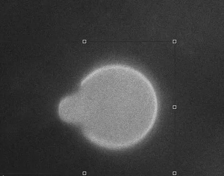

# MicroPipette-Aspiration-Setup
This contains a detailed methodology to build a micro-pipette aspiration setup for micro-biology and synthetic biology experiments with lipid bio-membranes.


Setup involves:
1. A syringe Pump, [Harvard 33DS](https://www.harvardapparatus.com/pump-33-dds-dual-drive-system-syringe-pump.html), controlled in Python via the code: https://github.com/harshjn/MicroPipette-Aspiration-Setup/blob/main/SyringeControl_GUI.py
2. Pressure Sensing setup as detailed in: https://github.com/harshjn/OpenSensorDAQ
3. Data Acquisition from NI DAQ in Python via: https://github.com/harshjn/MicroPipette-Aspiration-Setup/blob/main/optimized-daq-measurement.py
4. Volume Chamber with air-water interface for pressure control with a syringe pump in [Airtight tube](https://www.fluigent.com/research/instruments/sample-reservoirs/p-cap-series/)
5. The experimental setup is detailed in the image below:


## Citation
Cite this project as:

```bibtex
@misc{jain2025micropipette,
  author       = {Jain, Harsh},
  title        = {{MicroPipette-Aspiration-Setup}: A Methodology to Build a
                  Micropipette Aspiration Setup for Microbiology and Synthetic
                  Biology Experiments with Lipid Biomembranes},
  year         = {2026},
  publisher    = {GitHub},
  howpublished = {\url{https://github.com/harshjn/MicroPipette-Aspiration-Setup}}
}
```
